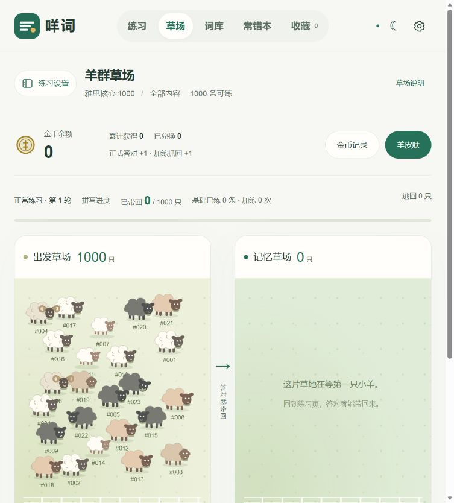

# 咩词 · Mieci

从自己的雅思备考需求出发，做一个能持续使用的英语打字练习工具。

「咩」既是羊的叫声，也有粤语“什么”的意思。每个词条对应一只羊，答对就把它带到记忆草场，进入加练时它会逃回来。

**[在线体验](https://jarvisyaokw.github.io/)** · [产品案例](docs/CASE_STUDY.md) · [技术设计](docs/ARCHITECTURE.md) · [开发与测试](docs/DEVELOPMENT.md)


## 为什么做

我希望同时练习英文拼写和键盘输入，并能使用自己的词库。练习需要随时中断、下次继续，新导入的词也应加入当前轮次。常错词和收藏词需要再次出现。

咩词将这些需求做成可公开访问的网页。无需注册学习账号，词库和练习记录保存在当前浏览器中。

## 当前功能

| 场景       | 实现                                                           |
| ---------- | -------------------------------------------------------------- |
| 拼写与认义 | 完整拼写、可调字母提示、按 1–4 选择中文；支持单词、短语和句子  |
| 持续学习   | 整库随机出题、保存当前题目、新词加入当前轮次                   |
| 巩固重点   | 两次尝试、跳过、只练认义、常错本、收藏与有限次数加练           |
| 理解词汇   | 音标、发音、例句、可开关英文释义，以及词形词族拓展             |
| 练习反馈   | 羊群映射正式练习进度，金币与六种初始皮肤                       |
| 数据管理   | 预置词库、CSV / JSON / 受支持的有道 BIN 导入、完整备份导出恢复 |



### 预置词库

| 词库                        | 词条数 |
| --------------------------- | -----: |
| 雅思核心词汇 · 通用高频筛选 |  1,000 |
| 雅思词汇真经 · 22 主题      |  3,632 |
| 雅思词汇 · ECDICT           |  5,040 |
| 大学英语四级词汇 · ECDICT   |  3,849 |
| 大学英语六级词汇 · ECDICT   |  5,407 |

不同词库有重叠。来源、整理方式与许可见[数据说明](wordbooks/NOTICE.txt)。

## 快速运行

需要 Node.js 22 或更高版本。运行和测试使用内置模块，无需安装运行时依赖。

```sh
git clone https://github.com/JarvisYaoKW/JarvisYaoKW.github.io.git
cd JarvisYaoKW.github.io
npm start
```

打开 `http://127.0.0.1:8080/`。自定义端口：`npm start -- --port=8081`。

```sh
npm test       # 关键学习规则与数据验证
npm run check  # JavaScript 语法检查
```

完整步骤见[开发与测试](docs/DEVELOPMENT.md)。线上通过 GitHub Pages 的 `main` 分支根目录发布。

## 我的工作与 AI 协作

我提出学习需求，确定练习与判分规则，主导布局、操作流程、羊群与奖励机制的设计，并通过实际使用持续提出问题、验证修改。

AI 辅助代码实现、调试、测试、文档整理和部署。此仓库展示个人需求到产品的迭代过程，不将 AI 生成代码描述为全部手写开发。

## 数据与边界

- 学习数据保存在当前浏览器 IndexedDB；跨设备通过完整备份迁移。清除网站数据会清除本机记录。
- 词典补全与发音会向第三方服务请求当前词条或音频。离线能力取决于资源是否已缓存。
- BIN 解析基于已验证样本格式，不保证兼容所有有道导出版本。
- 羊群与奖励用于练习反馈，尚未通过对照研究验证长期记忆效果。
- 目前没有持续的用户量、留存率或学习成效统计。

## 后续方向

收集自愿测试反馈；继续拆分主页面模块；增加浏览器交互测试；完善移动端与服务失败体验；按现有编号扩展羊皮肤。

## 来源与许可

ECDICT 数据采用 MIT 许可，见[完整许可](wordbooks/ECDICT-LICENSE.txt)。《雅思词汇真经》词表见[单独来源说明](wordbooks/scripture-source-notice.txt)。其他词典与音频资料遵循各自来源规则。

应用代码尚未指定通用开源许可证，各类资料不共享同一套再分发授权。反馈与修改建议见[贡献说明](CONTRIBUTING.md)。
