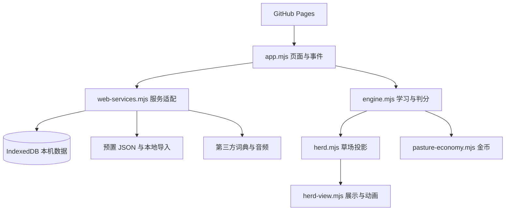

# 技术设计

应用使用原生 JavaScript ES Modules、HTML 和 CSS。GitHub Pages 提供静态文件；浏览器执行练习逻辑并保存学习状态。公开版本没有学习账号服务器。

## 模块

| 模块                                        | 职责                                               |
| ------------------------------------------- | -------------------------------------------------- |
| `engine.mjs`                                | 词条合并、范围、轮次、出题、两次尝试、成绩与加练   |
| `browser-storage.mjs`                       | IndexedDB、校验、修订号冲突检查、题目草稿          |
| `web-services.mjs`                          | 浏览器存取、导入、词典与音频适配                   |
| `bin-parser.mjs`                            | 已支持的 BIN 格式解析，拒绝错误输入                |
| `herd.mjs` / `herd-view.mjs`                | 正常学习状态到羊状态的映射与展示                   |
| `pasture-economy.mjs`                       | 金币、交易记录、皮肤编号与兑换                     |
| `pronunciation-*.mjs`                       | 音标和词性关联、答案展示模型                       |
| `verb-forms.mjs`                            | 按当前动词义筛选词形，合并同拼写的时态并生成拓展题 |
| `english-definitions.mjs` / `wordbooks.mjs` | 英文释义与预置词库管理                             |
| `app.mjs`                                   | 页面、事件、快捷键与答案流程，后续仍适合继续拆分   |

## 状态约束

1. 英文去除首尾空格、忽略大小写后合并，追加不同释义并保留成绩。
2. 完整拼写与字母提示共用 `rounds.typing`，中文选择使用 `rounds.choice`。
3. 首次错误允许重试，两次错误才增加一次正式错误；已完成题目重复提交不再次计分。
4. 草场读取正式轮次；正式加练令已捕获的羊逃回，不创建自己的队列。
5. 正式答对奖励一次金币，含重试改对和加练；照打、回看和拓展不经过正式奖励入口。
6. 保存时修订号不一致则拒绝覆盖，减少多标签页冲突。
7. 动词词形练习须有当前收录的动词义；中英文提示均按动词词性筛选。缺失对应英文释义时显示待补充，已有的词形缓存也须经过同一筛选。

数据库名称沿用 `cijian-typing-v1`。品牌更名时保留存储标识，兼容已有进度。

## 网络与限制

Service Worker 缓存页面及已读取的词库。未缓存的词库、在线词典补全和音频仍可能需要网络。

公开版可能向 Free Dictionary API、Wiktionary 和有道音频服务发送当前词条请求。本机保存与完全离线是不同能力。

自动测试主要覆盖纯逻辑与词库一致性，不覆盖真实 IndexedDB、音频播放、快捷键冲突和所有移动设备；完整端到端测试与性能基准仍待完善。
