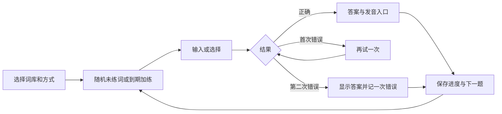

# 产品案例：从雅思备考到咩词

## 起点

项目来自我的实际需求：为雅思机考练习英文输入，同时记忆单词、短语和句型。我已有自己的词库，希望不断导入，并将练习接续到第二天。

## 设计取舍

| 问题                 | 选择                               | 原因与边界                       |
| -------------------- | ---------------------------------- | -------------------------------- |
| 词库太大，一次练不完 | 保存整轮进度和当前题目             | 新词加入当前轮次，支持跨天继续   |
| 同一英文有多个意思   | 按规范化英文合并、追加不同释义     | 保留已有成绩与分组               |
| 一次按错是否算不会   | 两次机会，两次错误才记一次正式错误 | 同时保留首答正确统计             |
| 只想认识部分单词     | 跳过，以及只练认义标记             | 区分阅读词汇和拼写词汇           |
| 提示和输入分散       | 提示字母所在位置直接输入           | 减少视线切换                     |
| 设置入口堆砌         | 顶部主导航加集中式练习设置         | 主区围绕当前题目                 |
| 进度过于抽象         | 一词一羊，两个草场映射学习结果     | 共用正常成绩，不引入独立游戏轮次 |
| 希望提供奖励         | 正式答对获得金币，六款初始皮肤保留 | 奖励不改变判分，学习效果仍待验证 |
| 朋友也想使用         | 静态网页与浏览器本地保存           | 简化入口，设备之间通过备份迁移   |

## 用户流程

照打与词形词族拓展从答案进入，结束后回到正式题目。草场和金币均与正式练习结果关联。

## 角色与协作

我负责需求、验收标准、学习规则、布局方向、草场隐喻与奖励机制，以及真实使用中的问题反馈。AI 辅助实现、排查、测试和部署。这是个人产品实践与 AI 协作项目，不代表独立手写全部代码。

## 验证范围

已有公开运行版本及核心规则自动测试。此前朋友测试过 EdgeOne 临时链接的大陆访问；GitHub Pages 是另一个地址，访问效果需要单独测试。

尚未建立持续访问统计、留存指标或学习效果对照实验，不将浏览量写成活跃用户量。

## 下一轮反馈记录

在参与者同意后，记录日期、设备网络、测试任务、预期与实际结果、修复版本及复测结论。优先验证能否顺利开始练习和中途接续，再讨论更细的产品指标。
